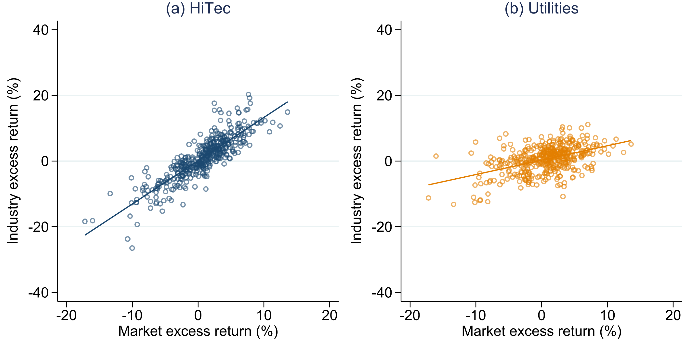
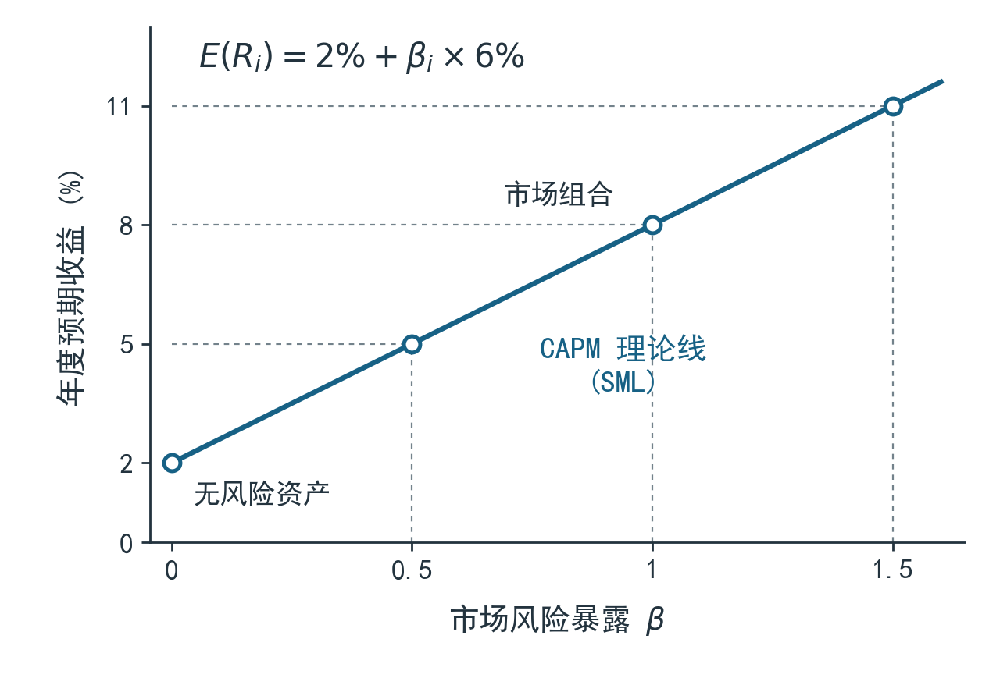
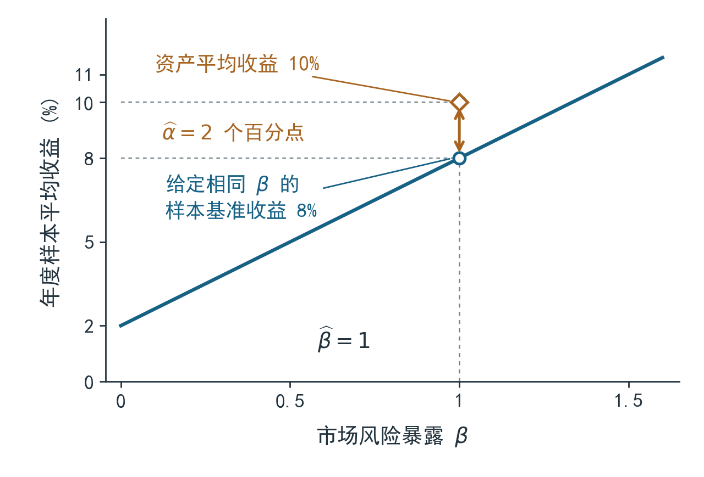
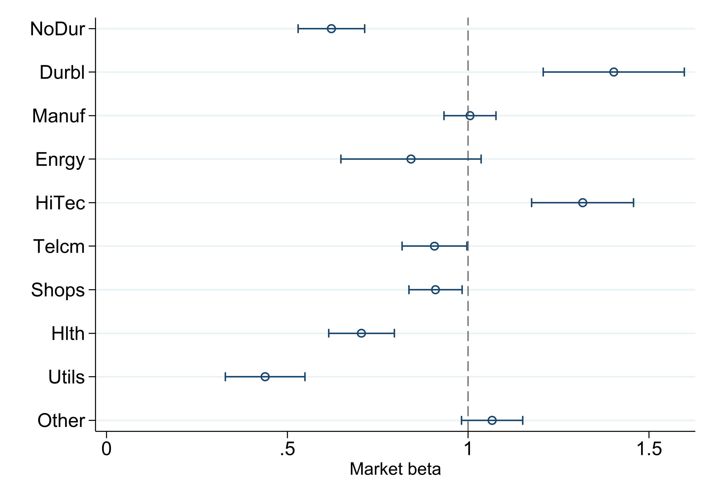
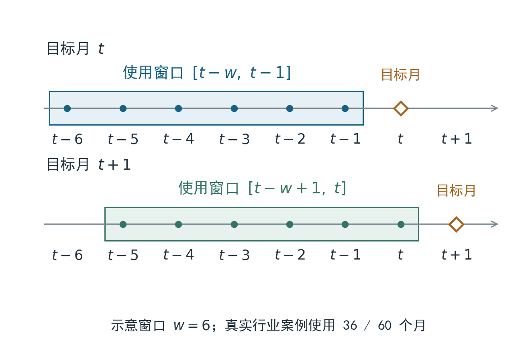
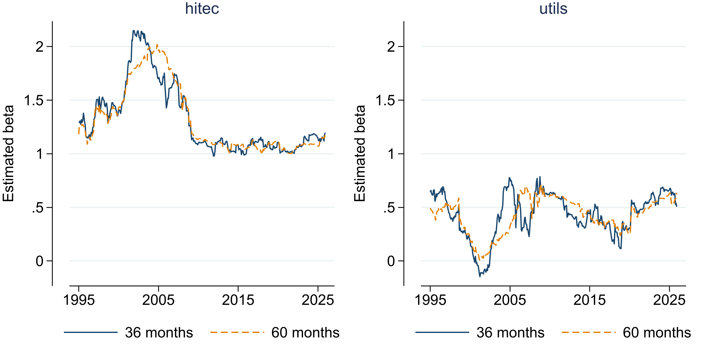
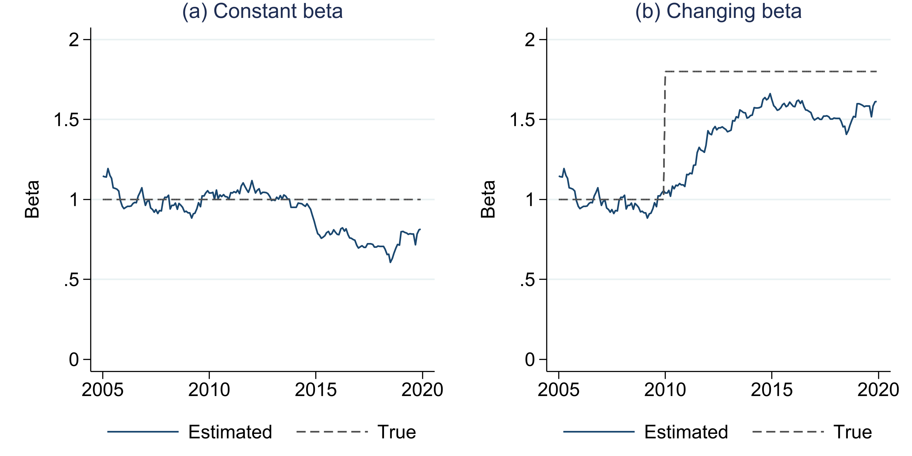

::: {.callout-note title="本讲要点"}

1. 区分资产自身的波动与市场风险暴露，解释 $\beta$ 的含义。
2. 将 CAPM 的预期收益关系与实际使用的市场回归联系起来。
3. 用一致口径的月度数据估计 $\alpha$、$\beta$ 及其不确定性。
4. 阅读 $\beta$ 在实证研究中的不同用途，区分参数变化与估计噪声。

:::

## 收益与风险 {#sec-capm-returns}

比较两项投资时，我们往往先看它们赚了多少。但收益较高，可能只是因为承担了更多与市场共同变化的风险。本节先明确收益比较的对象，再引入贯穿本章的行业组合案例。

### 收益比较 {#sec-capm-comparison}

假设我们受托评价两个行业组合。一个主要投资于科技企业，另一个主要投资于公用事业企业。样本期内，科技组合的平均收益较高，但价格波动也较大。我们能否据此判断科技组合的投资表现更好？

这个判断需要一个比较基准。若科技组合在市场上涨时涨得更多、下跌时也跌得更多，那么较高的平均收益可能与它承担的市场风险有关。相反，一个平均收益稍低的组合，如果对市场共同波动的暴露很小，也可能具有不同的评价结果。需要比较的既有收益水平，也有获得这些收益时承担了什么风险。

资本资产定价模型 (capital asset pricing model, CAPM) 为这类比较提供了一个基准。在相应条件下，模型将资产的预期超额收益与市场风险暴露联系起来。这里的关键不是给每一项波动都定价，而是考察资产与市场组合共同变化的部分。

本章先解释这一风险指标，再说明模型对预期收益提出了什么限制。随后使用美国行业组合月度数据估计市场暴露，并用几篇应用论文说明 $\beta$ 如何进入资产定价检验、基准评价和投资组合的构建。最后通过滚动估计与模拟，讨论风险暴露随时间变化时需要注意的问题。

先比较不同资产的长期表现。@tbl-capm-history 汇总美国市场 1926—2021 年的年度收益：股票的平均收益高于公司债和国库券，收益波动也更大。表中的波动率是总风险指标，后文再引入衡量市场共同风险的 $\beta$。

:::: {.capm-table}

| 统计量 | 小盘股票 | S&P 500 | AAA 公司债 | 国库券 $R_{f}$ |
|:---|---:|---:|---:|---:|
| 平均收益(%) | 18.6 | 12.2 | 6.2 | 3.3 |
| 收益标准差(%) | 38.6 | 19.7 | 6.3 | 3.1 |
| 平均超额收益(%) | 15.3 | 8.9 | 2.9 | 0.0 |

: 美国资产的长期收益与波动 {#tbl-capm-history tbl-colwidths="[28,18,18,18,18]"}

::: {.table-note}
注：样本为 1926—2021 年，共 96 年，均采用年度收益。平均收益为算术平均，标准差衡量年度实现波动，超额收益为资产收益减去国库券收益。股票收益包含股息再投资，公司债为约 20 年到期的 AAA 级美国公司债组合，国库券为 30 天美国国库券。平均收益取自 Berk and DeMarzo (2024) 表 10.3；标准差和超额收益取自表 10.5。
:::

::::

国库券放在最后一列，作为接下来计算超额收益的基准。按匹配期限持有到期时，当期国库券收益可以在期初确定；长期滚动再投资的年度收益仍会随各年短期利率变化，因此表中跨年的标准差为 3.1%。

### 超额收益 {#sec-capm-excess}

设 $R_{i,t}$ 为资产 $i$ 在第 $t$ 期的持有期收益率，$R_{f,t}$ 为同一期限的无风险收益率。资产的**超额收益**定义为

$$
r_{i,t}=R_{i,t}-R_{f,t}.
$$ {#eq-capm-excess}

下标 $i$ 区分资产，$t$ 区分时间。后文用 $R_{m,t}$ 表示市场组合收益，并将市场超额收益记为 $r_{m,t}=R_{m,t}-R_{f,t}$。同一笔资金也可以获得无风险收益，因此，比较承担市场风险得到的回报时，我们先扣除这部分基准收益。

例如，某月行业组合收益为 2%，同月无风险收益为 0.3%，该组合的超额收益为 1.7%。这里减的是同一个月的收益，不能把年化国债收益率直接从月度股票收益中扣除。若原始利率是年化报价，还需要辨认报价规则和对应期限，再转为所需的持有期口径。

本章的真实案例统一使用月度简单收益。数据以百分数存储，数值 1 表示当月收益 1%。这种单位下，回归截距的单位也是每月百分数，市场斜率 $\beta$ 则没有单位。简单收益与对数收益不是同一个量，替换时应重新说明模型和解释，不能只改变量名。

::: {.callout-tip title="配套案例与代码"}

正文中的简短代码展示关键计算，完整的数据准备、估计、循环和绘图见 [CAPM 实验](../notebooks/capm/capm-stata.html)，也可[下载 Notebook](https://lianxhcn.github.io/FinEco/notebooks/capm/capm-stata.ipynb){download="capm-stata.ipynb"}或[PDF 讲义](capm-lecture.pdf)。较长的操作配有提示词，供读者复制给 Agent。

本章使用两份固定数据：[行业月收益](../data/capm/industry_monthly.dta)和[模拟数据](../data/capm/beta_sim.dta)，变量与单位见[数据说明](../data/capm/README.md)。从 [FinEco 仓库](https://github.com/lianxhcn/FinEco) 下载课件后，在 Stata 中将工作目录设为课件项目根目录，即包含 [`data/`](https://github.com/lianxhcn/FinEco/tree/main/data)、[`lectures/`](https://github.com/lianxhcn/FinEco/tree/main/lectures) 和 [`notebooks/`](https://github.com/lianxhcn/FinEco/tree/main/notebooks) 的文件夹；正文代码按出现顺序承接已准备的变量，相对路径均从该目录起算。

:::

## 市场风险 {#sec-capm-risk}

资产的收益既会受到共同因素影响，也会受到自身因素影响。先把这两部分区分开，才能解释为什么总波动和市场 $\beta$ 可能给出不同的风险排序。

### 共同波动 {#sec-capm-comovement}

经济增长、融资条件或投资者风险偏好的变化，可能同时影响许多资产。企业自身的产品、管理或诉讼信息，则可能主要影响某一家公司。对持有大量资产的投资者而言，后者中的一部分可以通过分散持有相互抵消，而广泛作用于市场的共同变化较难用同一种方式消除。

本章的科技和公用事业行业各自包含多家公司的股票，是按市值加权构造的行业组合。分散持有已经抵消了一部分公司特有的波动，但同行业公司仍会共同受到技术、政策或成本变化的影响。因此，行业组合既有整个市场的共同风险，也会保留行业层面的风险。对于持仓集中的投资者，公司特有风险同样会影响组合的实际波动。

为了观察共同变化，我们可以将一个行业组合每月的超额收益放在纵轴，将市场超额收益放在横轴。若散点围绕一条向上倾斜的直线分布，说明该组合与市场存在正向的线性联系。直线的斜率描述共同变化的幅度，散点偏离直线的程度则描述单一市场因素没有解释的部分。

先画科技行业的一幅市场回归图。下面两次减法对应式 ([-@eq-capm-excess])；`scatter` 画每月观测，`lfit` 加上带截距的 OLS 拟合线。

```stata
use data/capm/industry_monthly.dta, clear
generate double ex_hitec = hitec - rf
generate double ex_utils = utils - rf
twoway (scatter ex_hitec mktrf, msymbol(Oh)) ///
    (lfit ex_hitec mktrf), legend(off)
```

`mktrf` 已是市场超额收益；`hitec` 和 `utils` 为行业原始月收益，减去同月 `rf` 后才是纵轴所用的超额收益。完整的双面板图还需统一坐标与尺寸，可以按下面的提示词生成。

::: {.callout-tip title="提示词 市场回归图" .callout-prompt}

读取 [`data/capm/industry_monthly.dta`](../data/capm/industry_monthly.dta)。用 `mdate` 核对 1990 年 1 月至 2025 年 12 月连续的 432 个月。以 `hitec-rf`、`utils-rf` 为纵轴，已扣除无风险收益的 `mktrf` 为横轴，分别画空心圆散点和带截距的 OLS 拟合线。合并为一行两列、近方形绘图区，两图横轴统一为 −20 至 20、纵轴为 −40 至 40，保留全部月份。给出 Stata 代码，解释斜率对应的风险暴露；保持原数据不变。

:::

:::: {.capm-figure}

{#fig-capm-market width=100%}

::: {.figure-note}
注：每个面板保留 1990 年 1 月至 2025 年 12 月的 432 个月。横轴和纵轴均为当月超额收益，单位为百分数；实线为带截距的 OLS 拟合线，两图采用共同坐标范围。数据来自 French 金融数据库。
:::

::::

@fig-capm-market 中，科技行业的拟合线较陡，公用事业行业的拟合线较平。它们对同样幅度的市场超额收益变化，给出不同的拟合收益变化。同时，两个行业都存在偏离直线的观测值，单一市场因素并未概括全部收益波动。@fig-capm-market 中的线是实现收益之间的回归线，后文的证券市场线有不同的坐标与含义。

### 风险暴露 {#sec-capm-beta}

在总体线性回归中，资产对市场的风险暴露可以写成

$$
\begin{aligned}
\beta_{i}
&=\frac{\operatorname{Cov}(r_{i},r_{m})}
        {\operatorname{Var}(r_{m})}\\
&=\frac{\rho_{im}\sigma_{i}\sigma_{m}}{\sigma_{m}^{2}}
 =\rho_{im}\frac{\sigma_{i}}{\sigma_{m}}.
\end{aligned}
$$ {#eq-capm-beta}

其中，$\operatorname{Cov}$ 表示协方差，$\operatorname{Var}$ 表示方差，$\rho_{im}$ 是两种超额收益的相关系数，$\sigma_{i}$ 与 $\sigma_{m}$ 分别是它们的标准差。从协方差形式到最右侧的表达，使用了相关系数的定义 $\operatorname{Cov}(r_{i},r_{m})=\rho_{im}\sigma_{i}\sigma_{m}$，以及 $\operatorname{Var}(r_{m})=\sigma_{m}^{2}$，再约去一个 $\sigma_{m}$。协方差定义要求二阶矩存在且市场超额收益方差为正；写成相关系数形式时，资产超额收益的方差也须为正。

沿用上段已经生成的超额收益变量，样本协方差与方差可以直接给出这一斜率：

```stata
correlate ex_hitec mktrf, covariance
matrix V = r(C)
matrix list V
display "beta = " %7.3f (V[1,2] / V[2,2])
```

对应的实际输出为：

```text
symmetric V[2,2]
           ex_hitec      mktrf
ex_hitec   44.64431
   mktrf  25.366888  19.266073
beta =   1.317
```

Stata 以对称矩阵形式显示 `V`，省略重复的上三角元素。因此，`V[1,2]` 与输出中的 `V[2,1]` 相同。这里的 `V` 是两列收益的协方差矩阵，与系数估计的方差矩阵 `e(V)` 是不同对象。

变量顺序决定了 `V` 的行列含义：`V[1,2]` 为行业与市场的样本协方差，`V[2,2]` 为市场的样本方差。两者相除得到的约 1.317，与同一样本带截距回归的斜率一致；这把式 ([-@eq-capm-beta]) 的定义落实到了数据。

第一个等式说明，$\beta$ 衡量的是资产与市场共同变化的幅度，相对于市场自身变化作了标准化。最后一个表达式进一步表明，$\beta$ 同时取决于相关程度和相对波动。资产波动很大，但若主要来自与市场联系较弱的因素，其 $\beta$ 未必很大。

例如，若市场超额收益标准差为 4%，某资产的标准差为 8%、相关系数为 0.2，则 $\beta$ 为 0.4。另一资产的标准差只有 5%，但相关系数为 0.8，$\beta$ 为 1。前者自身波动较大，市场暴露却较小。这两个数值说明，总波动较大与市场暴露较大是两回事。

当 $\beta=1$ 时，市场超额收益变化 1 个百分点，对应资产拟合超额收益约变化 1 个百分点。$\beta=1.5$ 时，对应变化约为 1.5 个百分点；$\beta=0.5$ 时，约为 0.5 个百分点。这些数值描述回归线的斜率。对于期限匹配、持有到期的无风险资产，收益在期初已经确定，超额收益为零，因此 $\beta=0$。零 $\beta$ 表示没有线性市场暴露；其他资产即使 $\beta=0$，也可能仍有自身的收益波动。

### 风险分解 {#sec-capm-decomposition}

沿用 OLS 单元的回归表示，可以写出

$$
\begin{aligned}
r_{i}&=\alpha_{i}+\beta_{i}r_{m}+\varepsilon_{i},\\
E(\varepsilon_{i})&=0,\\
\operatorname{Cov}(\varepsilon_{i},r_{m})&=0.
\end{aligned}
$$ {#eq-capm-projection}

$\alpha_{i}$ 是截距，$\varepsilon_{i}$ 是随机干扰项。这里将总体回归系数定义为使平均平方拟合误差最小的一组常数，因此随机干扰项的均值为零，与市场超额收益的协方差也为零。这两个条件不要求随机干扰项与市场相互独立，也不构成市场因素具有因果外生性的证明。

由于截距是常数，且随机干扰项与市场超额收益的协方差为零，取方差可得

$$
\operatorname{Var}(r_{i})
=\beta_{i}^{2}\operatorname{Var}(r_{m})
+\operatorname{Var}(\varepsilon_{i}).
$$ {#eq-capm-variance}

左边是资产超额收益的总方差。右边第一项为线性市场成分对应的方差，第二项为该回归没有解释的方差。这里称作特质部分，是相对于所选单因子基准而言；遗漏的其他共同因素 (如行业共同波动，以及规模、价值、盈利或投资等因子) 也可能进入残差。因此，残差较大不能自动解释为纯粹的企业独有风险。

这一分解也解释了 $\beta$ 与拟合优度的区别。带截距的一元总体回归满足

$$
R_{i}^{2}
=\frac{\beta_{i}^{2}\operatorname{Var}(r_{m})}
        {\operatorname{Var}(r_{i})}
=\rho_{im}^{2}.
$$ {#eq-capm-r2}

$R_{i}^{2}$ 描述总方差中被该线性市场成分解释的比例。$\beta$ 较大不必然意味着这个比例较大，因为总方差也可能很大。反过来，高 $R^{2}$ 说明市场回归拟合较紧，并不说明 CAPM 的预期收益限制已经通过检验。

## 资本资产定价模型 {#sec-capm-model}

市场回归能够描述共同变化，但还没有回答承担这些风险应得到多少预期回报。CAPM 增加的是一个关于风险补偿的均衡关系。本节区分这一关系、它需要的条件，以及实际回归中对应的检验对象。

### 定价关系 {#sec-capm-pricing}

考虑同一投资期，$R_{f}$ 是该期已知的无风险收益率。CAPM 的基本关系为

$$
E(R_{i})-R_{f}
=\beta_{i}\left[E(R_{m})-R_{f}\right].
$$ {#eq-capm-pricing}

$E(R_{i})$ 是资产的预期收益率，$E(R_{m})-R_{f}$ 是市场风险溢价。$\beta$ 表示承担了多少市场风险，市场风险溢价表示每单位这种暴露对应的预期补偿。在这里，$\beta$ 与预期收益针对同一投资期和同一市场组合定义。

用一组年度教学数值说明：假设无风险收益为 2%，市场预期收益为 8%，则市场风险溢价为 6%。$\beta$ 为 0.5 的资产，其模型预期收益为 $2\%+0.5\times6\%=5\%$；$\beta$ 为 1.5 时，模型预期收益为 11%。无风险资产的 $\beta$ 为零，对应的预期收益为 2%。

以 $\beta$ 为横轴、资产预期收益为纵轴，式 ([-@eq-capm-pricing]) 描述的直线称为**证券市场线** (security market line, SML)。它比较不同资产的预期收益与风险暴露。@fig-capm-market 则以每月市场实现收益为横轴、某一行业实现收益为纵轴，刻画一项资产的时间序列关系。两条线都用到 $\beta$，但市场回归图比较同一资产在不同月份的实现收益，证券市场线比较不同资产的预期收益。@fig-capm-sml 将刚才的年度数值画在同一条线上。

:::: {.capm-figure}

{#fig-capm-sml width=88%}

::: {.figure-note}
注：年度教学设定为无风险收益 2%、市场预期收益 8%。$\beta=0$、0.5、1 和 1.5 分别对应 2%、5%、8% 和 11% 的模型预期收益。横轴为风险暴露，纵轴为预期收益。
:::

::::


### 模型条件 {#sec-capm-assumptions}

为什么在这个模型中，预期收益补偿与协方差有关？投资者持有的是组合。一项资产加入组合后，给组合风险带来的边际变化，不只取决于它自身波动，还取决于它与原组合如何共同变化。在基本 CAPM 中，市场组合成为所有投资者共同持有的风险资产组合，资产与它的协方差因此进入风险补偿关系。

基本 CAPM 的关键假设可以概括为：

1. **单期组合选择。** 投资者针对同一投资期作决策，厌恶风险，并按组合的预期收益和方差选择持仓。
2. **一致预期。** 投资者对各资产收益的均值、方差和协方差具有相同判断。
3. **共同的无风险利率。** 投资者可以按相同的无风险利率借入或贷出资金。
4. **理想化的交易条件。** 资产可以细分和交易，模型忽略税收、交易成本以及卖空等交易限制。
5. **市场出清。** 各资产的总需求等于供给，投资者的组合选择与资产价格共同达到均衡。

这些假设使投资者持有相同构成的风险资产组合，再按风险承受能力搭配无风险资产或借款。市场出清时，该风险资产组合就是市场组合，由此得到式 ([-@eq-capm-pricing])。

理论中的市场组合包括模型所考虑的全部风险资产，按市场价值持有。实证中往往只能观察到股票指数或研究数据库构造的市场收益，它们是市场组合的**代理**。若某项检验与模型不一致，还要检查代理是否合适、收益和样本是否可比，而不能把某一指数直接等同于全部风险财富。

组合选择、有效前沿以及从最优组合到市场均衡的完整推导，放在后续投资组合章。本章先使用这一关系，学习如何度量市场暴露并据此比较收益。

### 模型与回归 {#sec-capm-model-regression}

对式 ([-@eq-capm-projection]) 取期望，由于随机干扰项均值为零，可以得到

$$
\alpha_{i}=E(r_{i})-\beta_{i}E(r_{m}).
$$ {#eq-capm-alpha}

如果采用适当的市场组合，且相应稳定参数设定下的 CAPM 定价关系成立，右边应为零。因此，经验研究常从带截距的市场回归开始，估计 $\alpha$，再检验截距是否显著异于零。带截距的估计式使这一模型限制可以直接接受检验。

$\alpha$ 衡量平均超额收益与市场基准所解释部分之间的差额。@fig-capm-alpha 用年度数值展示这一含义：以同一样本内的平均无风险收益 2%、市场平均收益 8% 为例，若 $\widehat{\beta}=1$，资产的样本基准收益为 8%；当资产平均收益为 10% 时，估计截距 $\widehat{\alpha}$ 为 2 个百分点。这一差额也可能来自模型遗漏的风险因素，评价基金经理能力还需要进一步分析。

:::: {.capm-figure}

{#fig-capm-alpha width=88%}

::: {.figure-note}
注：年度样本的图解设定为无风险收益 2%、市场平均收益 8%，资产 $\widehat{\beta}=1$、平均收益 10%。竖直距离为资产平均收益与样本基准收益之差，即 $\widehat{\alpha}=2$ 个百分点。
:::

::::


::: {.callout-warning title="定价限制与拟合程度"}

$\beta$ 描述风险暴露，$R^{2}$ 描述线性拟合程度，$\alpha$ 则涉及给定基准解释后剩余的平均收益。三者回答不同问题。$\alpha$ 不显著，只表示当前样本与推断条件下没有足够证据拒绝零截距，不能据此宣布 CAPM 已被证明。

:::

## 参数估计 {#sec-capm-estimation}

下面将理论对象落实为数据、估计式和结果说明。整个比较固定行业样本、月份、市场代理与收益单位，避免将口径变化误认为风险暴露变化。

### 数据准备 {#sec-capm-data}

本例使用 [French 金融数据库](https://mba.tuck.dartmouth.edu/pages/faculty/ken.french/data_library.html) 的美国十行业市值加权组合月收益，以及同源因子文件中的市场超额收益与无风险收益。主样本固定为 1990 年 1 月至 2025 年 12 月，共 432 个月，每个行业使用相同月份，没有自动填补缺失值。

科技行业记为 HiTec，公用事业行业记为 Utils。它们是行业组合。采用这组数据，可以让资产收益、市场代理与无风险收益在同一市场和频率下衔接。行业组合的构造范围及来源说明见[数据说明](../data/capm/README.md)。

数据中保留了两类收益：`hitec` 和 `utils` 是含股息的行业月收益；`mktrf` 来自因子文件的 `Mkt-RF`，已经等于市场月收益减去同月无风险收益。`rf` 则是该月的无风险收益。因此，行业超额收益按 `hitec-rf`、`utils-rf` 计算，市场超额收益直接使用 `mktrf`。

@tbl-capm-data 展示固定数据的前六行，便于对照变量和数值。原文件包含十个行业，这里只列出主案例用到的两列。

:::: {.capm-table}

| 月份 | `hitec` | `utils` | `mktrf` | `rf` |
|:---|---:|---:|---:|---:|
| 1990-01 | −1.47 | −5.35 | −7.80 | 0.57 |
| 1990-02 | 4.04 | 0.21 | 1.12 | 0.57 |
| 1990-03 | 4.63 | −0.75 | 1.83 | 0.64 |
| 1990-04 | −1.94 | −5.52 | −3.36 | 0.69 |
| 1990-05 | 12.41 | 5.43 | 8.43 | 0.68 |
| 1990-06 | −1.27 | 0.75 | −1.09 | 0.63 |

: 行业月收益数据的前六行 {#tbl-capm-data tbl-colwidths="[24,19,19,19,19]"}

::: {.table-note}
注：除月份外，数值均为每月百分数。`hitec`、`utils` 为行业收益，`mktrf` 已扣除无风险收益，`rf` 为同月无风险收益。来源为本章固定的行业月收益数据文件。
:::

::::

例如，1990 年 1 月科技行业超额收益为 $-1.47\%-0.57\%=-2.04\%$，公用事业行业为 $-5.35\%-0.57\%=-5.92\%$；市场超额收益直接取 −7.80%。

表中数值采用百分数单位，例如 1.00 表示当月收益 1%。下面按这一口径生成行业超额收益并设置月度时间变量：

```stata
use data/capm/industry_monthly.dta, clear
format mdate %tm
tsset mdate, monthly
generate double ex_hitec = hitec - rf
generate double ex_utils = utils - rf
```

`mdate` 为 Stata 月日期，`hitec`、`utils` 为行业月收益，`rf` 为同月无风险收益，`mktrf` 为已经扣除无风险收益的市场列。数据源对历史收益会作修订，本章冻结取得的历史版本，并不重建每个历史时点当时可获得的数据。[来源说明](https://mba.tuck.dartmouth.edu/pages/faculty/ken.french/Data_Library/f-f_factors.html)还记录了 2024 年 6 月起 RF 来源的变化。遇到版本差异，应先核对来源和处理，再比较估计结果。

本章的行业回归和模拟演示分别调用 [`data/capm/industry_monthly.dta`](../data/capm/industry_monthly.dta) 和 [`data/capm/beta_sim.dta`](../data/capm/beta_sim.dta)。前者为真实行业月收益，后者为固定的教学模拟；分析过程中不重新下载或抽取随机数。两份数据的变量、单位、来源、生成方法和使用边界见[章级数据说明](../data/capm/README.md)。

### 市场回归 {#sec-capm-regression}

在固定样本上估计

$$
r_{i,t}=\alpha_{i}+\beta_{i}r_{m,t}+\varepsilon_{i,t}.
$$ {#eq-capm-estimation}

其中 $t=1,\ldots,T$，$T$ 是样本月份数。本例 $T=432$。估计时，$\alpha$、$\beta$ 在所用窗口内被当作固定参数；如果真实暴露随时间变化，整段样本的系数只能概括这一窗口内的关系，不能自动代表每个月的风险。

OLS 单元已经说明，带截距的一元 OLS 斜率为

$$
\begin{aligned}
\widehat{\beta}_{i}
&=\frac{\sum_{t=1}^{T}(r_{m,t}-\bar r_{m})
                         (r_{i,t}-\bar r_{i})}
        {\sum_{t=1}^{T}(r_{m,t}-\bar r_{m})^{2}},\\
\widehat{\alpha}_{i}
&=\bar r_{i}-\widehat{\beta}_{i}\bar r_{m}.
\end{aligned}
$$ {#eq-capm-sample-beta}

$\bar r_{i}$ 和 $\bar r_{m}$ 分别是样本平均超额收益。这个表达便于把估计结果与收益比较联系起来：样本平均超额收益由市场暴露对应的部分与截距两部分组成。这里是样本拟合的代数关系，不能再把它作为模型成立的独立证据。

```stata
regress ex_hitec mktrf
regress ex_utils mktrf
```

本例科技行业的 $\beta$ 约为 1.317，公用事业行业约为 0.439。前者对市场共同波动的暴露更大。科技行业的月平均原始收益约为 1.317%，公用事业行业约为 0.830%；但扣除同月无风险收益，并用各自的市场暴露调整后，两者的 $\alpha$ 分别约为每月 0.121% 和 0.282%。因此，原始平均收益的排序与截距的排序不同。

评价两个行业的投资表现，还需要考察 $\alpha$ 的估计精度，以及所选市场因素是否适合作为评价基准。

### 统计推断 {#sec-capm-inference}

市场回归中的随机干扰项可能在不同时期具有不同方差，也可能存在时间相关。异方差稳健标准误处理方差差异，但不自动处理跨期相关。对时间序列回归，可以在适当的弱依赖和样本条件下使用异方差与自相关稳健推断 (heteroskedasticity and autocorrelation consistent, HAC)。

本例采用 Newey–West 标准误，最大滞后设为 6 个月：

```stata
newey ex_hitec mktrf, lag(6)
test _cons = 0
test mktrf = 1
```

`newey` 保留该样本上的 OLS 点估计，改变方差估计方式。`lag(6)` 用于规定本次方差估计考虑的滞后范围，是教学选择，不是所有月度数据的固定答案。样本长度、依赖特征和分析目标变化时，需要重新评估该设置。遗漏变量、市场代理选择和风险暴露变化，则属于需要另外处理的模型设定问题。

`test _cons = 0` 检查零截距限制，`test mktrf = 1` 检查暴露是否等于市场本身的单位暴露。$\beta$ 显著异于零，不等于 CAPM 获得支持；许多具有共同市场波动的资产都可能满足这一统计特征，而预期收益限制仍可能不成立。

@tbl-capm-main 各列可以从 Stata 返回结果中读取。以科技行业为例，下面先查看原始收益的均值和标准差，再查看 OLS 拟合优度，最后读取 HAC 推断下的参数及标准误：

```stata
quietly summarize hitec
display "mean = " %7.3f r(mean) "  sd = " %7.3f r(sd)
quietly regress ex_hitec mktrf
display "R-squared = " %7.3f e(r2)
quietly newey ex_hitec mktrf, lag(6)
display "alpha = " %7.3f _b[_cons]
display "beta = " %7.3f _b[mktrf]
display "SE(beta) = " %7.3f _se[mktrf]
```

`_b[_cons]` 对应截距，`_b[mktrf]` 对应市场斜率，`_se[mktrf]` 为当前估计方法给出的斜率标准误。`e(r2)` 给出式 ([-@eq-capm-r2]) 对应的样本拟合优度，在 OLS 回归后读取；均值和标准差则来自尚未扣除无风险收益的 `hitec`。完整 Notebook 对每个行业依次估计、保存这些结果，再整理为表格。

:::: {.capm-table}

| 行业 | 月平均收益 | 月标准差 | $\alpha$ | $\beta$ | $\beta$ 的 HAC 标准误 | $R^{2}$ |
|:---|---:|---:|---:|---:|---:|---:|
| 科技 | 1.317 | 6.682 | 0.121 | 1.317 | 0.072 | 0.748 |
| 公用事业 | 0.830 | 4.042 | 0.282 | 0.439 | 0.056 | 0.227 |

: 两行业的收益与市场回归 {#tbl-capm-main tbl-colwidths="[14,17,15,9,9,26,10]"}

::: {.table-note}
注：均值和标准差来自行业原始月收益，$\alpha$ 来自超额收益回归，三者均以每月百分数表示；$\beta$ 及其标准误无单位。样本为相同的 432 个月，标准误采用 HAC(6)。
:::

::::

科技行业 $\alpha$ 的 HAC 标准误约为 0.184，公用事业行业约为 0.179，对应的双侧检验 $p$ 值分别约为 0.510 和 0.115。在这组样本与设定下，二者都没有在 5% 水平拒绝 $\alpha=0$。公用事业的截距点估计较高，但估计不确定性使我们不能只按两个点估计断言它存在稳定的超额表现。

注意，@tbl-capm-main 中有两种不同的尺度。$\beta$ 为 1.317 不表示月收益 1.317%，这里与科技行业原始均值在三位小数上相同只是数值巧合。$\alpha$ 为 0.121% 表示每月约 12.1 个基点；不能把这个月度截距直接称为年化超额收益。即使采用乘以 12 的算术换算，也不等同于复利投资的年增长率。

### 估计精度 {#sec-capm-precision}

同一个 $\beta$ 点估计，可能来自信息充分的长样本，也可能来自少量、分散程度较高的观测。报告风险暴露时，应把估计精度一起给出。沿用前面介绍的区间估计，在本例中采用

$$
\mathrm{CI}_{95}=\widehat{\beta}\ \pm\ c\cdot
\operatorname{se}(\widehat{\beta}).
$$ {#eq-capm-ci}

$\mathrm{CI}_{95}$ 表示当前资产的 95% 置信区间，减号和加号分别给出区间下限与上限。为突出公式结构，这里省略资产下标；$\widehat{\beta}$ 为该资产的斜率估计值，$\operatorname{se}(\widehat{\beta})$ 为采用最大滞后 6 个月计算的 HAC 标准误。$c$ 是自由度为 $T-2$ 的 $t$ 分布的 97.5% 分位数，其中 $T$ 为回归样本的月份数，扣除的两个参数为截距和斜率。本例 $T=432$，使用这一临界值与 Stata 输出保持一致。

HAC 推断依赖大样本近似，使用 $t$ 临界值不意味着误差可以任意相关时仍有精确的小样本覆盖率。$\alpha$ 的区间用相同方法构造。

下面片段对应式 ([-@eq-capm-ci])，直接计算科技行业斜率区间的两个端点：

```stata
quietly newey ex_hitec mktrf, lag(6)
scalar c = invttail(e(df_r), .025)
display "95% CI lower = " %7.3f (_b[mktrf] - c * _se[mktrf])
display "95% CI upper = " %7.3f (_b[mktrf] + c * _se[mktrf])
```

`invttail` 返回给定自由度的上尾临界值；本例 `e(df_r)` 为 430。端点约为 1.176 和 1.457，与 @tbl-capm-ci 对应。将参数名换为 `_cons`，并读取相应标准误，即可计算截距区间。

手动读取系数、标准误和临界值，有助于理解区间怎样形成。实证分析中，通常先保存各次估计，再用结果输出命令集中整理。[`esttab`](https://repec.sowi.unibe.ch/stata/estout/help-esttab.html) 是 `estout` 包中的外部命令，首次使用前可运行 `ssc install estout`。下面两条输出命令分别报告系数与标准误、系数与 95% 置信区间：

```stata
quietly newey ex_hitec mktrf, lag(6)
estimates store capm_hitec
quietly newey ex_utils mktrf, lag(6)
estimates store capm_utils
esttab capm_hitec capm_utils, b(3) se(3) nostar
esttab capm_hitec capm_utils, b(3) ci(3) level(95) nostar
```

输出以两个行业为列，`mktrf`、`_cons` 两行为斜率与截距；`b(3)`、`se(3)` 和 `ci(3)` 将显示精度设为三位小数。`se` 与 `ci` 分别选择标准误和区间，`nostar` 省略显著性星号。`esttab` 从已保存的估计结果中读取系数、方差和自由度，本例因此仍采用 HAC(6) 标准误及自由度为 430 的 $t$ 临界值；它不会另外选择标准误。区间端点应与 @tbl-capm-ci 一致。完整 Notebook 还演示将结果导出为可用 Word 打开的 RTF 文件。

:::: {.capm-table}

| 行业 | $\alpha$ 的 95% 区间 | $\beta$ 的 95% 区间 |
|:---|---:|---:|
| 科技 | [−0.241, 0.483] | [1.176, 1.457] |
| 公用事业 | [−0.069, 0.634] | [0.328, 0.549] |

: 两行业参数的置信区间 {#tbl-capm-ci tbl-colwidths="[20,40,40]"}

::: {.table-note}
注：$\alpha$ 的单位为每月百分数，$\beta$ 无单位。均使用 HAC(6) 标准误及相应 $t$ 临界值，区间逐个构造。
:::

::::

从 @tbl-capm-ci 看，两个 $\alpha$ 区间都包括零。科技行业的 $\beta$ 区间整体位于 1 上方，公用事业行业整体位于 1 下方；这与前面的风险暴露比较一致。但即使这些 $\beta$ 估得较精确，模型是否能解释不同资产的平均收益，仍需要另外评价。一个参数可以精确估计，经济模型对它施加的其他限制却未必满足。

区间中的不确定性也有明确范围。这里在固定市场代理、固定样本和固定回归设定下衡量抽样不确定性，没有把更换市场指数、改用日数据或调整行业构造带来的差异都计入其中。若研究结论依赖这些选择，可以再做有针对性的敏感性分析，并说明每次改变了什么。

### 行业比较 {#sec-capm-industries}

将相同估计推广到十个行业，可以观察市场暴露的异质性。@fig-capm-betas 给出各行业 $\beta$ 和逐个构造的 95% 区间。竖向虚线对应 $\beta=1$，便于比较各行业与单位市场暴露的差别。

批量生成参数表和行业区间图时，需要把每次估计保存为一行，再将上下限画成横线。下面的提示词把表格口径与绘图口径一并固定。

::: {.callout-tip title="提示词 参数表与行业比较" .callout-prompt}

读取 [`data/capm/industry_monthly.dta`](../data/capm/industry_monthly.dta)。十个行业收益列为 `nodur durbl manuf enrgy hitec telcm shops hlth utils other`；每列减去同月 `rf` 后，对 `mktrf` 作带截距回归。各行业使用相同的 432 个月，`newey` 最大滞后为 6，区间临界值用自由度 430 的 $t$ 分布。

保存原始收益的均值、标准差，回归截距、斜率、HAC 标准误和逐个 95% 区间；拟合优度从同样本 OLS 读取。整理科技与公用事业的参数表、区间表，再画十行业斜率的横向区间图：空心圆表示点估计，横线表示区间，竖向虚线位于 1。说明区间的计算代码与收益单位，并与本章 @tbl-capm-main、@tbl-capm-ci 和 @fig-capm-betas 核对。

:::

:::: {.capm-figure}

{#fig-capm-betas width=86%}

::: {.figure-note}
注：各行业均使用 1990—2025 年的 432 个月和同一市场代理。横线为采用 HAC(6) 标准误与相应 $t$ 临界值构造的逐个 95% 区间，不是同时置信区间，未作多重比较校正。虚线为 $\beta=1$。
:::

::::

@fig-capm-betas 中耐用消费品和科技行业的市场暴露较高，公用事业、非耐用消费品与医疗行业较低。能源行业的月收益标准差约为 6.429%，$\beta$ 却约为 0.842；科技行业标准差约为 6.682%，$\beta$ 约为 1.317。两个行业总波动接近，共同市场暴露却明显不同。这正是式 ([-@eq-capm-beta]) 所强调的相关程度与总波动的区别。

单独估计多个行业，可以描述风险暴露，但并未完成严格的联合资产定价检验。逐一查看 $\alpha$ 的 $p$ 值，还会涉及多重比较与联合误差结构。需要对一组资产的定价限制做正式研究时，应进一步选择相应联合检验或横截面方法，而不能只统计有多少个星号。

若将科技与公用事业组合每月各配置一半，在同一样本、同一市场回归与截距设定下，其 $\beta$ 等于两个成分 $\beta$ 的加权平均，约为 0.878。配套 Notebook 核对了这条线性恒等式。固定每月权重意味着需要再平衡，实际组合还涉及交易成本和可交易性，评价实际策略时还需考虑这些因素。

固定权重关系也可以用很短的代码检查。下面将每月两个行业的超额收益各取一半，再估计同一市场回归：

```stata
generate double ex_portfolio = .5*ex_hitec + .5*ex_utils
regress ex_portfolio mktrf
display "beta = " %7.3f _b[mktrf]
```

得到的斜率约为 0.878。完整实验还保存两个成分的斜率，并检查组合斜率与其加权平均之差接近零。这就从数据中核对了固定权重组合的斜率关系。

## 文献应用 {#sec-capm-literature}

$\beta$ 的估计在实证研究中有不同用途。下面六篇论文分别讨论横截面定价、低风险异象、投资组合、条件风险与风险预测。阅读时，需要同时了解论文检验了什么、怎样使用 $\beta$，以及得到了什么结论。

### 横截面定价 {#sec-capm-fama}

Fama and French ([1992](https://doi.org/10.1111/j.1540-6261.1992.tb04398.x)) 研究了美国股票平均收益的横截面差异，检验市场 $\beta$ 能否解释不同股票的平均收益。论文的主要发现是：在 1963 年 7 月至 1990 年 12 月的样本中，当组合设计允许 $\beta$ 与公司规模分别变化时，平均收益与 $\beta$ 的关系近乎平坦；公司规模和账面市值比则具有较强的解释力。小规模、高账面市值比股票的平均收益较高；加入这两项特征后，杠杆率和盈利市价比不再提供明显的额外解释力。

为区分规模与 $\beta$ 的作用，作者每年 6 月先按公司规模分为十组，再在各规模组内按此前 24 至 60 个月估计的 $\beta$ 分为十组，形成 100 个组合。这样可以比较规模相近、$\beta$ 不同的股票，而不只是沿着规模与 $\beta$ 同时变化的方向比较。

论文随后用这 100 个组合在整个检验期的收益序列估计组合 $\beta$，并将组合 $\beta$ 赋给当年属于该组合的个股，以降低个股风险暴露的估计噪声。再逐月进行个股层面的 Fama–MacBeth 横截面回归，检验 $\beta$、规模和账面市值比等变量是否获得平均收益补偿。这里的全样本组合 $\beta$ 服务于定价检验，不是投资者在每个历史时点都已知道的风险预测。

这篇论文质疑的是市场 $\beta$ 足以解释股票平均收益差异这一 CAPM 预测。它没有否定 $\beta$ 衡量市场风险暴露的用途，也不是用时间序列回归的 $R^{2}$ 判断模型是否成立。

### 业绩基准 {#sec-capm-baker}

Baker et al. ([2011](https://doi.org/10.2469/faj.v67.n1.4)) 研究了低风险股票为何能长期获得较好的投资表现。他们分别按历史波动率和 $\beta$ 对美国股票排序，发现 1968—2008 年间，低波动、低 $\beta$ 组合不仅回撤较小，平均收益也优于相应的高风险组合。这一低风险异象与承担更高市场风险应获得更高预期收益的简单预测不符。

作者提出的解释结合了投资者对高风险股票的偏好与机构投资者的基准考核约束。基金经理通常相对于固定基准接受评价，且不能自由使用杠杆。即使低 $\beta$ 股票具有正 $\alpha$，增持它们带来的跟踪误差也可能使经理不愿偏离基准；因此，机构资金未必会及时纠正高风险股票的高估。

在这项研究中，$\beta$ 用于分组，并进入相对基准的业绩评价。按总波动排序和按 $\beta$ 排序是两项不同的检验；论文观察到的历史收益差异与提出的解释机制，也应分别理解。

### 构建投资组合 {#sec-capm-frazzini}

Frazzini and Pedersen ([2014](https://doi.org/10.1016/j.jfineco.2013.10.005)) 研究了融资约束如何影响资产价格，并提出反向贝塔策略 (betting against beta, BAB)。其机制是：不能自由加杠杆的投资者会偏向高 $\beta$ 资产，以提高组合的市场暴露。这种需求抬高了高 $\beta$ 资产的价格，使其风险调整后的预期收益低于低 $\beta$ 资产。

BAB 因子做多低 $\beta$ 组合、做空高 $\beta$ 组合，并依据事前估计的 $\beta$ 调整两侧规模，使多空两侧各具有单位市场暴露，因而整体事前市场暴露接近零。论文在多个股票市场及债券、期货等资产中发现，BAB 获得了显著为正的风险调整收益；融资条件收紧时，BAB 的表现则较差。这些结果与融资约束模型的预测一致。

这里的 $\beta$ 直接决定头寸规模，而不仅是分组标签。若低估了多头组合的 $\beta$，为达到单位暴露而施加的杠杆就会偏大。论文对波动率和相关性采用了不同窗口，并对 $\beta$ 作收缩处理；本章的月度 OLS 只能说明风险暴露的计算，不能代替 BAB 的完整复现。

### 时变特征 {#sec-capm-ang}

Ang and Chen ([2007](https://doi.org/10.1016/j.jempfin.2005.12.001)) 重新考察了价值股相对成长股的收益优势能否由 CAPM 解释。作者研究了 1926—2001 年的长期样本，允许市场 $\beta$、市场风险溢价和系统波动随时间变化，估计相应的条件 CAPM。

论文发现，账面市值比组合的 $\beta$ 存在明显的时变特征；在所设定的条件模型下，高账面市值比减去低账面市值比策略的条件 $\alpha$ 缺乏显著异于零的证据。因而，固定参数 OLS 所得到的显著价值溢价，不能直接解释为该条件模型也无法解释的异常收益。这一结果依赖论文的模型与推断方法，不能由简单滚动回归替代。

Gormsen and Jensen ([2024](https://doi.org/10.1016/j.jfineco.2024.103933)) 进一步研究了时变市场风险对常见股票策略 $\alpha$ 的影响。在覆盖 23 个发达国家的样本中，他们发现，控制条件风险可以解释价值、投资、动量等策略的一部分无条件 $\alpha$。但条件 CAPM 仍不能解释全部异常收益，模型仍被拒绝。

条件 CAPM 把给定期初信息时的资产预期超额收益，与该信息下的市场暴露和市场预期超额收益联系起来。滚动 OLS 概括的是一段历史窗口内的回归关系；画出斜率曲线只是度量时变暴露的起点。

两项研究都要求把 $\beta$ 的变化与同期市场补偿联系起来。对本章而言，滚动曲线只能展示局部风险暴露；要判断这种变化解释了多少平均收益，还需估计条件定价模型，不能只观察曲线是否波动。

### 预测风险暴露 {#sec-capm-drobetz}

Drobetz et al. ([2025](https://doi.org/10.1017/S0022109024000036)) 比较了传统估计方法与机器学习方法预测美国股票未来市场 $\beta$ 的表现。研究将历史 $\beta$、换手率、规模等信息用于预测，再用后续数据评价预测误差，并考察对冲、市场中性策略和最小方差组合的表现。

论文发现，机器学习方法在统计预测和投资组合应用中均优于所比较的传统基准，随机森林的总体表现最好。使用相同解释变量时，树模型和神经网络仍优于线性回归，说明它们对非线性关系和变量交互作用的刻画具有实际价值。历史 $\beta$、换手率和规模是重要的预测变量。

这项研究中的 $\beta$ 是需要预测的风险参数。其结果说明，估计方法应按后续用途评价：较小的预测误差能否转化为较小的对冲误差或较好的组合表现，需要另作检验。本章的滚动 OLS 提供了一个基础比较方法，不能仅凭样本内拟合优度判断哪种风险预测更有效。

::: {.callout-tip title="文献阅读" .callout-reading}

阅读使用 $\beta$ 的论文时，可先记录四件事：$\beta$ 相对于哪个市场或因子估计，使用哪些历史观测，估计误差怎样处理，以及估计值如何进入排序、权重或后续检验。完整文献与公开全文入口列在章末，正文中的行业实验与这些论文的原始研究分别看待。

:::


## 时变风险 {#sec-capm-timevarying}

企业业务、资本结构和行业环境可能变化，市场共同波动的方式也可能变化。整段样本估得的 $\beta$ 因而未必足以描述当前暴露。本节采用一个简短的滚动估计例子，再用已知参数的模拟说明解释边界。

### 滚动估计 {#sec-capm-rolling}

假设我们站在目标月 $t$ 开始时，只使用此前 $w$ 个月的数据。每向前移动一个月，就移出最早的观测、加入刚结束月份的观测，再估计一次市场回归。这称为滚动窗口估计。@fig-capm-window 用两个相邻窗口展示这一过程。

:::: {.capm-figure}

{#fig-capm-window width=100%}

::: {.figure-note}
注：图中用 $w=6$ 个月示意：阴影带为估计窗口，目标月位于窗口右侧。目标月为 $t$ 时，使用 $t-6$ 至 $t-1$；移到 $t+1$ 时，使用 $t-5$ 至 $t$。后文实证分别采用 36 和 60 个月窗口。
:::

::::


相应斜率为

$$
\widehat{\beta}_{i,t}^{(w)}
=\frac{\sum_{s=t-w}^{t-1}
        (r_{m,s}-\bar r_{m,t}^{(w)})
        (r_{i,s}-\bar r_{i,t}^{(w)})}
       {\sum_{s=t-w}^{t-1}
        (r_{m,s}-\bar r_{m,t}^{(w)})^{2}}.
$$ {#eq-capm-rolling}

$s$ 表示窗口内月份，$w$ 表示窗口长度，$\bar r_{m,t}^{(w)}$ 与 $\bar r_{i,t}^{(w)}$ 是这段历史窗口内的样本均值。上标 $(w)$ 用于标记采用的窗口长度。注意求和在 $t-1$ 结束，没有使用目标月 $t$ 尚未发生的收益。

例如，将目标月设为 2025 年 12 月，下面只使用此前 60 个月估计科技行业的斜率：

```stata
use data/capm/industry_monthly.dta, clear
generate double ex_hitec = hitec - rf
local t = tm(2025m12)
regress ex_hitec mktrf if inrange(mdate, `t'-60, `t'-1)
display "beta = " %7.3f _b[mktrf]
```

区间右端的 `t-1` 对应式 ([-@eq-capm-rolling]) 的求和上限，保证目标月本身没有进入回归。将目标月向前移动并重复估计，才得到整条滚动曲线。

本例分别取 36 个月和 60 个月。为了在相同目标月份比较，两条曲线均从 1995 年 1 月开始，到 2025 年 12 月结束。每个行业、每种窗口得到 372 个估计值。36 个月窗口本可更早开始，但这里统一比较区间，不把不同覆盖时期的曲线直接放在一起解释。

::: {.callout-tip title="提示词 滚动风险暴露" .callout-prompt}

读取 [`data/capm/industry_monthly.dta`](../data/capm/industry_monthly.dta)，将 `hitec`、`utils` 各减去 `rf`，对 `mktrf` 作带截距的滚动 OLS。目标月份统一为 1995 年 1 月至 2025 年 12 月；分别使用目标月之前 36、60 个月，每组应有 372 个估计。结果保存 `industry window mdate end_used beta`，核验 `end_used=mdate-1`，共 1,488 行。每个行业画两种窗口曲线，合并为一行两列，使用共同纵轴范围。给出循环代码及窗口端点检查，并解释 @fig-capm-rolling 中曲线变化的含义。

:::

:::: {.capm-figure}

{#fig-capm-rolling width=92%}

::: {.figure-note}
注：实线为此前 36 个月的 OLS 估计，虚线为此前 60 个月的估计；每个目标月均只使用截至前一个月的收益。两种窗口在相同目标月份比较，曲线不是置信区间，也未给出参数变化的正式检验。
:::

::::

### 窗口选择 {#sec-capm-window}

短窗口较快反映最近样本的变化，同时也可能受到少量极端月份的较大影响。长窗口包含更多观测，通常能减弱某些抽样波动，但也可能把不同状态混在一起，对新的风险关系反应较慢。选择窗口是在信息量与对变化的响应之间作取舍，不能仅按曲线是否平滑判断优劣。

@fig-capm-rolling 中，同一行业的两条曲线有时差异较大。解释这种差异时，应先检查窗口覆盖了哪些月份。例如，一个特殊市场时期进入或移出窗口，都可能改变样本协方差与市场方差，进而改变斜率。相邻窗口大部分观测相同，其估计值也不是相互独立的。

如果任务是描述历史关系，可以查看不同窗口下的估计及其不确定性。如果任务是形成未来持仓，则还需按当时可得信息确定参数、权重和交易规则，并进行相应的样本外评价。本章仅核对滚动估计的时间边界，没有把这组历史曲线包装成无前视的投资策略。

### 参数与噪声 {#sec-capm-noise}

真实数据中的 $\beta$ 不可直接观察。看到滚动估计变化，可能是因为真实参数变化，也可能是有限窗口中的市场收益和随机干扰项恰好发生了不同组合。为了区分这两种解释，我们可以先在已知真值的数据中做一个对照。

从 [`data/capm/beta_sim.dta`](../data/capm/beta_sim.dta) 读取预先生成并冻结的 240 个月模拟数据。市场超额收益设为 $x_{t}=0.5+4z_{t}$，随机干扰项设为 $u_{t}=4v_{t}$，其中 $z_{t}$ 与 $v_{t}$ 为相互独立、跨期独立的标准正态变量，数值单位仍为每月百分数。第一条收益序列采用固定 $\beta$：

$$
y_{t}^{(1)}=x_{t}+u_{t}.
$$ {#eq-capm-sim-fixed}

第二条序列使用相同的 $x_{t}$ 和 $u_{t}$，只改变斜率：

$$
\begin{aligned}
y_{t}^{(2)}&=b_{t}x_{t}+u_{t},\\
b_{t}&=
\begin{cases}
1,&t\leq120,\\
1.8,&t>120.
\end{cases}
\end{aligned}
$$ {#eq-capm-sim-changing}

$y_{t}^{(1)}$ 和 $y_{t}^{(2)}$ 为两条模拟超额收益，$b_{t}$ 为第二条序列的斜率真值。两条序列的截距均为零。这里采用 0.5、4、1 和 1.8 作为教学设定。数据在首次生成时固定随机种子，随后各次实验只读取同一文件，分别使用此前 60 个月估计两条序列的 $\beta$。

数据文件已经保存了这两条生成关系，可用断言逐项核对：

```stata
use data/capm/beta_sim.dta, clear
assert abs(ex_fixed - mktrf - eps) < 1e-10
assert abs(ex_change - beta_true*mktrf - eps) < 1e-10
list mdate beta_true in 119/122
```

`mktrf` 对应模拟市场收益，`eps` 对应随机干扰项，`ex_fixed`、`ex_change` 对应式 ([-@eq-capm-sim-fixed]) 和式 ([-@eq-capm-sim-changing])。最后一行查看变化点附近的真值；常规演示只读取固定数据，不再生成随机数。

::: {.callout-tip title="提示词 参数变化与估计噪声" .callout-prompt}

读取 [`data/capm/beta_sim.dta`](../data/capm/beta_sim.dta) 的 240 个月。分别将 `ex_fixed`、`ex_change` 对 `mktrf` 作带截距的滚动 OLS，每次只用目标月之前 60 个月，从第 61 月至第 240 月各得 180 个斜率。第一条真值始终为 1，第二条真值取文件中的 `beta_true`；`eps` 保留为两条序列共用的随机干扰项。将估计值与目标月真值画为一行两列的对照图，与 @fig-capm-simulation 核对。仅使用这份冻结模拟，不减真实数据的 `rf`，说明估计噪声和窗口滞后分别怎样影响曲线。

:::

:::: {.capm-figure}

{#fig-capm-simulation width=100%}

::: {.figure-note}
注：左图真值始终为 1，右图在第 121 个月由 1 变为 1.8。两组共用市场收益与随机干扰项，实线为此前 60 个月的滚动估计，虚线为目标月真值。模拟月份从 2000 年 1 月开始，日期只用于展示时间轴，不对应真实市场事件。
:::

::::

@fig-capm-simulation(a) 中，真实 $\beta$ 从未变化，滚动估计仍在约 0.607 至 1.193 之间波动。这说明，即使真实参数保持不变，滚动估计也会因窗口内的样本不同而发生变化。

@fig-capm-simulation(b) 改变了真值。因为每个目标月的估计只使用过去数据，参数刚变化时，窗口仍包含大量旧状态观测，估计不会立即跳到 1.8。之后新状态观测逐渐替代旧状态，曲线才反映新的关系。这种逐渐调整的形态来自窗口中新旧观测的替换。

::: {.callout-warning title="时变风险的判断"}

滚动曲线适合描述局部样本关系，但不能单独区分真实参数变化、估计噪声与模型遗漏。若要正式研究时变 $\beta$，应进一步说明信息集、参数动态和推断方式。增加滚动图并不会自动把固定参数 CAPM 升级为经过验证的条件资产定价模型。

:::

## 习题 {#sec-capm-tasks}

回到 @tbl-capm-main 的行业比较，科技行业在样本期内平均原始收益较高，同时也具有更高的市场暴露。公用事业行业的截距点估计较高，但其不确定性仍然较大。因此，收益评价需要同时报告样本、基准、风险暴露与估计精度。仅给出平均收益排名，或只强调一个正 $\alpha$，都不足以完成这项任务。

下面三项练习分别检查风险解释、条件变化和组合衔接。配套 Notebook 保存基础结果，改变条件前应先写出预期，再用输出核对。

1. **风险比较。** 从十行业中选择两个总波动接近、$\beta$ 不同的行业。结合相关性、市场回归图与 $R^{2}$，说明总波动排序为何不能替代市场暴露排序。明确使用相同样本和收益单位。
2. **推断与窗口。** 固定资产、月份和回归变量，改变 HAC 最大滞后；再固定数据处理与推断任务，比较 36 和 60 个月窗口。分别解释哪些点估计应保持不变，哪些估计对象或不确定性可能改变。不要把某次显著性变化直接写成经济机制变化。
3. **组合衔接。** 用两个行业构造固定权重组合，核对组合 $\beta$ 与成分 $\beta$ 加权平均的关系。随后说明，如果权重随时间变化、交易成本不能忽略，为什么这条固定权重的计算关系不足以评价整个投资策略。

::: {.callout-tip title="提示词 结果核对" .callout-prompt}

请读取 [`data/capm/industry_monthly.dta`](../data/capm/industry_monthly.dta) 与 [`data/capm/beta_sim.dta`](../data/capm/beta_sim.dta)，对照 [`notebooks/capm/capm-stata.ipynb`](../notebooks/capm/capm-stata.html) 核对收益单位、行业收益扣除 `rf` 的处理、`mktrf` 是否已为超额收益、各行业样本，以及滚动窗口的 `end_used`。模拟另核对 `ex_fixed`、`ex_change` 与 `beta_true`、`eps` 的关系。逐项给出变量、代码位置和实际输出依据，区分真实行业数据与教学模拟，并列出尚不能从这些结果推出的判断。

:::


## 参考文献 {.unnumbered #sec-capm-references}

1. Ang, A., & Chen, J. (**2007**). CAPM over the long run: 1926–2001. *Journal of Empirical Finance*, 14(1), 1–40. [Link](https://doi.org/10.1016/j.jempfin.2005.12.001), [PDF](https://www.nber.org/papers/w11903.pdf), [Google](<https://scholar.google.com/scholar?q=CAPM+over+the+long+run+1926+2001>).
2. Baker, M., Bradley, B., & Wurgler, J. (**2011**). Benchmarks as limits to arbitrage: Understanding the low-volatility anomaly. *Financial Analysts Journal*, 67(1), 40–54. [Link](https://doi.org/10.2469/faj.v67.n1.4), [PDF](https://pages.stern.nyu.edu/~jwurgler/papers/wurgler_bradley_baker.pdf), [Google](<https://scholar.google.com/scholar?q=Benchmarks+as+Limits+to+Arbitrage+Understanding+the+Low-Volatility+Anomaly>).
3. Berk, J., & DeMarzo, P. (**2024**). *Corporate finance* (6th ed., Global ed.). Pearson. [Link](https://eu.pearson.com/corporate-finance-global-edition/9781292446356), [PDF 试读](https://www.pearson.de/media/muster/ext/9781292446417.pdf), [Google](<https://scholar.google.com/scholar?q=Berk%20DeMarzo%20Corporate%20Finance%206th%20Global%20Edition%202024>).
4. Drobetz, W., Hollstein, F., Otto, T., & Prokopczuk, M. (**2025**). Estimating stock market betas via machine learning. *Journal of Financial and Quantitative Analysis*, 60(3), 1074–1110. [Link](https://doi.org/10.1017/S0022109024000036), [PDF](https://www.cambridge.org/core/services/aop-cambridge-core/content/view/5D19DD38014A2C23E677F85BE5E7148A/S0022109024000036a.pdf/estimating-stock-market-betas-via-machine-learning.pdf), [Google](<https://scholar.google.com/scholar?q=Estimating+Stock+Market+Betas+via+Machine+Learning>).
5. Fama, E. F., & French, K. R. (**1992**). The cross-section of expected stock returns. *The Journal of Finance*, 47(2), 427–465. [Link](https://doi.org/10.1111/j.1540-6261.1992.tb04398.x), [PDF](https://traders.studentorg.berkeley.edu/papers/Fama%20and%20French.pdf), [Google](<https://scholar.google.com/scholar?q=The+Cross-Section+of+Expected+Stock+Returns>).
6. Frazzini, A., & Pedersen, L. H. (**2014**). Betting against beta. *Journal of Financial Economics*, 111(1), 1–25. [Link](https://doi.org/10.1016/j.jfineco.2013.10.005), [PDF](https://pages.stern.nyu.edu/~afrazzin/pdf/Betting%20Against%20Beta%20-%20Frazzini%20and%20Pedersen.pdf), [Google](<https://scholar.google.com/scholar?q=Betting+against+beta+Frazzini+Pedersen>).
7. Gormsen, N. J., & Jensen, C. S. (**2024**). Conditional risk. *Journal of Financial Economics*, 162, 103933. [Link](https://doi.org/10.1016/j.jfineco.2024.103933), [PDF](https://bpb-us-w2.wpmucdn.com/voices.uchicago.edu/dist/e/1646/files/2024/02/GormsenJensen2024-beaef8edd01a47f2.pdf), [Google](<https://scholar.google.com/scholar?q=Conditional+Risk+Gormsen+Jensen>).
